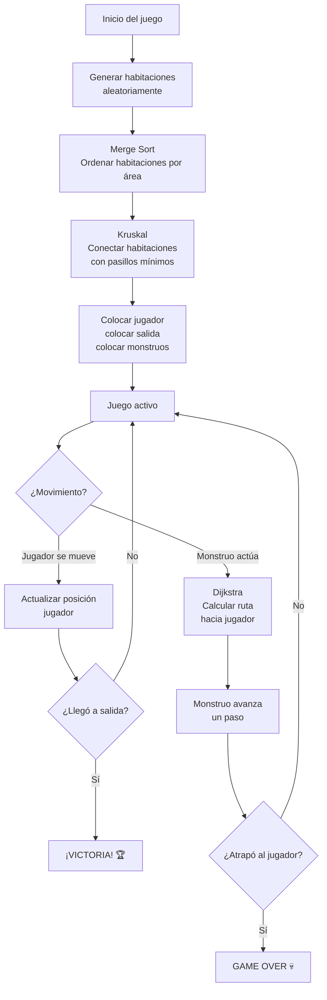

# 🏰 DungeonAlgorithm — Guía de Algoritmos para el Proyecto Final ADA

> [!IMPORTANT]
> El proyecto está en blanco. Usaremos **3 algoritmos de ADA** integrados en un juego de mazmorra Android. Cada algoritmo tiene un **rol real en el juego**, lo que hace que la exposición sea sólida y fácil de defender.

---

## 🗺️ ¿Cómo encajan los algoritmos en el juego?

```
┌─────────────────────────────────────────────────────────────────┐
│                     DUNGEON ALGORITHM GAME                      │
│                                                                 │
│  1. MERGE SORT          → Ordena ítems/habitaciones del mapa    │
│  2. KRUSKAL             → Genera los PASILLOS entre habitaciones │
│  3. DIJKSTRA            → Encuentra el camino más corto (IA/GPS) │
└─────────────────────────────────────────────────────────────────┘
```

---

## 📊 Algoritmo 1: Merge Sort — Ordenamiento de Habitaciones

### ¿Para qué sirve en el juego?
Cuando el mapa se genera con múltiples habitaciones (rooms), necesitamos **ordenarlas por tamaño, posición, o prioridad** (cuál mostrar primero, cuál tiene más monstruos, cuál conectar primero).

### ¿Cómo funciona?
Divide el arreglo por la mitad recursivamente hasta tener elementos individuales, luego los **fusiona (merge) ya ordenados**.

```
Arreglo original: [5, 2, 8, 1, 9, 3]

Dividir:
        [5, 2, 8]       [1, 9, 3]
       [5,2]  [8]     [1,9]  [3]
      [5] [2] [8]   [1] [9] [3]

Fusionar (merge):
      [2,5]   [8]     [1,9]  [3]
       [2, 5, 8]       [1, 3, 9]
           [1, 2, 3, 5, 8, 9]  ✅
```

### Complejidad
| Caso | Tiempo | Espacio |
|------|--------|---------|
| Mejor | O(n log n) | O(n) |
| Promedio | O(n log n) | O(n) |
| Peor | O(n log n) | O(n) |

> [!TIP]
> Merge Sort es **estable** (no reordena elementos iguales) y siempre garantiza O(n log n). Ideal para ordenar habitaciones por área antes de conectarlas.

### Código Kotlin
```kotlin
fun mergeSort(rooms: MutableList<Room>): List<Room> {
    if (rooms.size <= 1) return rooms

    val mid = rooms.size / 2
    val left = mergeSort(rooms.subList(0, mid).toMutableList())
    val right = mergeSort(rooms.subList(mid, rooms.size).toMutableList())

    return merge(left, right)
}

private fun merge(left: List<Room>, right: List<Room>): List<Room> {
    val result = mutableListOf<Room>()
    var i = 0; var j = 0

    while (i < left.size && j < right.size) {
        // Ordenar por área (ancho × alto)
        if (left[i].area() <= right[j].area()) result.add(left[i++])
        else result.add(right[j++])
    }
    result.addAll(left.subList(i, left.size))
    result.addAll(right.subList(j, right.size))
    return result
}
```

---

## 🌲 Algoritmo 2: Kruskal — Generación de Pasillos (Árbol de Expansión Mínima)

### ¿Para qué sirve en el juego?
Una vez que las habitaciones están en el mapa, necesitamos **conectarlas con pasillos** asegurándonos de que:
- Todas las habitaciones sean alcanzables (ninguna queda aislada).
- Los pasillos no formen ciclos innecesarios (laberinto eficiente).
- El total de pasillos construidos sea mínimo (Árbol de Expansión Mínima = MST).

### ¿Cómo funciona?
1. Calcula la distancia entre **todos los pares de habitaciones** (aristas con pesos).
2. **Ordena las aristas** de menor a mayor distancia.
3. Recorre las aristas en orden: si conectar dos habitaciones **NO forma un ciclo** → agrega el pasillo.
4. Usa **Union-Find (Disjoint Set)** para detectar ciclos eficientemente.

```
Habitaciones: A, B, C, D

Aristas ordenadas por distancia:
  A-B: 2  ← Agregar ✅ (no ciclo)
  C-D: 3  ← Agregar ✅ (no ciclo)
  A-C: 4  ← Agregar ✅ (no ciclo, conecta los 2 grupos)
  B-D: 7  ← SALTAR ❌ (formaría ciclo)
  B-C: 8  ← SALTAR ❌ (formaría ciclo)

Resultado MST: A-B-C-D todos conectados con solo 3 pasillos
```

### Complejidad
| Operación | Tiempo |
|-----------|--------|
| Ordenar aristas | O(E log E) |
| Union-Find | O(α(V)) ≈ O(1) |
| Total | O(E log E) |

> [!TIP]
> Con Kruskal garantizas que el mapa siempre tiene **exactamente `n-1` pasillos** para `n` habitaciones — el mínimo necesario para que todo sea accesible.

### Código Kotlin
```kotlin
class UnionFind(size: Int) {
    private val parent = IntArray(size) { it }
    private val rank = IntArray(size) { 0 }

    fun find(x: Int): Int {
        if (parent[x] != x) parent[x] = find(parent[x]) // Path compression
        return parent[x]
    }

    fun union(x: Int, y: Int): Boolean {
        val px = find(x); val py = find(y)
        if (px == py) return false // Ya están conectados → ciclo
        if (rank[px] < rank[py]) parent[px] = py
        else if (rank[px] > rank[py]) parent[py] = px
        else { parent[py] = px; rank[px]++ }
        return true
    }
}

fun kruskal(rooms: List<Room>): List<Pair<Room, Room>> {
    val edges = mutableListOf<Triple<Double, Int, Int>>()

    // Generar todas las aristas (distancias entre centros de habitaciones)
    for (i in rooms.indices)
        for (j in i + 1 until rooms.size)
            edges.add(Triple(rooms[i].distanceTo(rooms[j]), i, j))

    // Ordenar aristas por peso (distancia)
    edges.sortBy { it.first }

    val uf = UnionFind(rooms.size)
    val pasillos = mutableListOf<Pair<Room, Room>>()

    for ((_, i, j) in edges) {
        if (uf.union(i, j)) {           // Si NO forma ciclo → agregar pasillo
            pasillos.add(Pair(rooms[i], rooms[j]))
        }
    }
    return pasillos
}
```

---

## 🔎 Algoritmo 3: Dijkstra — Camino más Corto (IA del Enemigo / GPS del Jugador)

### ¿Para qué sirve en el juego?
Tiene **dos usos poderosos** en el juego:
1. **IA del enemigo:** El monstruo usa Dijkstra para encontrar la ruta más corta hacia el jugador.
2. **Pista al jugador:** Mostrar el camino óptimo hacia la salida (modo ayuda).

### ¿Cómo funciona?
1. Parte desde un nodo origen con distancia `0`. Todos los demás: `∞`.
2. Usa una **cola de prioridad (min-heap)** para siempre explorar primero el nodo más cercano.
3. Para cada vecino: si la nueva distancia es menor → actualiza y agrega a la cola.
4. Se detiene cuando llega al destino (o explora todo el grafo).

```
Mapa de celdas (0 = libre, # = pared):

  S . . # .
  . # . . .
  . # . # E

Dijkstra desde S hasta E:

  Paso 1: Explorar S (distancia 0)
  Paso 2: Vecinos de S: →(1), ↓(1)
  Paso 3: Explorar los más cercanos primero
  ...
  Resultado: Camino más corto marcado con *

  S * . # .
  . # * * .
  . # . # E  ← llega aquí en 6 pasos
```

### Complejidad
| Estructura | Tiempo |
|------------|--------|
| Con array simple | O(V²) |
| **Con min-heap (PriorityQueue)** | **O((V + E) log V)** |

> [!TIP]
> En un grid 2D donde cada celda es un nodo y solo tiene 4 vecinos (arriba, abajo, izquierda, derecha), Dijkstra es muy eficiente. Con pesos iguales (1 por paso) se comporta igual que BFS, pero Dijkstra permite terrenos con diferente costo (barro, lava, agua).

### Código Kotlin
```kotlin
data class Cell(val x: Int, val y: Int)

fun dijkstra(grid: Array<IntArray>, start: Cell, end: Cell): List<Cell> {
    val rows = grid.size; val cols = grid[0].size
    val dist = Array(rows) { IntArray(cols) { Int.MAX_VALUE } }
    val prev = Array(rows) { arrayOfNulls<Cell>(cols) }
    val pq = PriorityQueue<Pair<Int, Cell>>(compareBy { it.first })

    dist[start.x][start.y] = 0
    pq.add(Pair(0, start))

    val dirs = listOf(Cell(-1,0), Cell(1,0), Cell(0,-1), Cell(0,1))

    while (pq.isNotEmpty()) {
        val (d, curr) = pq.poll()
        if (d > dist[curr.x][curr.y]) continue
        if (curr == end) break

        for (dir in dirs) {
            val nx = curr.x + dir.x; val ny = curr.y + dir.y
            if (nx < 0 || nx >= rows || ny < 0 || ny >= cols) continue
            if (grid[nx][ny] == 1) continue // Pared

            val newDist = dist[curr.x][curr.y] + 1
            if (newDist < dist[nx][ny]) {
                dist[nx][ny] = newDist
                prev[nx][ny] = curr
                pq.add(Pair(newDist, Cell(nx, ny)))
            }
        }
    }

    // Reconstruir camino
    val path = mutableListOf<Cell>()
    var curr: Cell? = end
    while (curr != null) { path.add(0, curr); curr = prev[curr.x][curr.y] }
    return if (path.first() == start) path else emptyList()
}
```

---

## 🎮 Arquitectura General del Juego



---

## 📝 Plan para la Exposición de ADA

### Slide 1 — Presentación del Problema
> "Los videojuegos de mazmorras necesitan tres cosas: **generación eficiente del mapa**, **conectividad garantizada** y **comportamiento inteligente de enemigos**. Cada una se resuelve con un algoritmo clásico de ADA."

### Slide 2 — Merge Sort
- Qué ordena, por qué, complejidad O(n log n), demostración visual en la app.

### Slide 3 — Kruskal + Union-Find
- Qué conecta, cómo evita ciclos, complejidad O(E log E), mostrar el MST dibujado en el mapa.

### Slide 4 — Dijkstra
- Ruta del enemigo / ruta sugerida, comparar con BFS, mostrar animación del camino en la app.

### Slide 5 — Comparación y Optimizaciones realizadas
- Tabla comparativa de complejidades.
- Mejoras implementadas (ver sección siguiente).

---

## ⚡ Optimizaciones que puedes mencionar en la exposición

| Algoritmo | Versión Básica | Optimización Implementada | Resultado |
|-----------|---------------|--------------------------|-----------|
| Merge Sort | Crea nuevos arrays en cada fusión | In-place con índices | Menos memoria |
| Kruskal | Union simple | **Path Compression + Union by Rank** | O(α(n)) ≈ O(1) por operación |
| Dijkstra | Array lineal de distancias | **PriorityQueue (min-heap)** | O((V+E)logV) |

> [!NOTE]
> La optimización **Path Compression + Union by Rank** en Union-Find es una de las estructuras de datos más elegantes en CS. Hace que Kruskal sea casi lineal en la práctica. ¡Menciona esto en la exposición!

---

## 🚀 Próximos pasos para construir el juego

1. **[x] Entender los 3 algoritmos** ← estás aquí
2. **[ ] Crear los archivos Kotlin** en Android Studio
3. **[ ] Implementar el motor de generación de mazmorras**
4. **[ ] Implementar la pantalla del juego con Canvas/Compose**
5. **[ ] Integrar los 3 algoritmos con visualización de cada uno**
6. **[ ] Pruebas y presentación**
